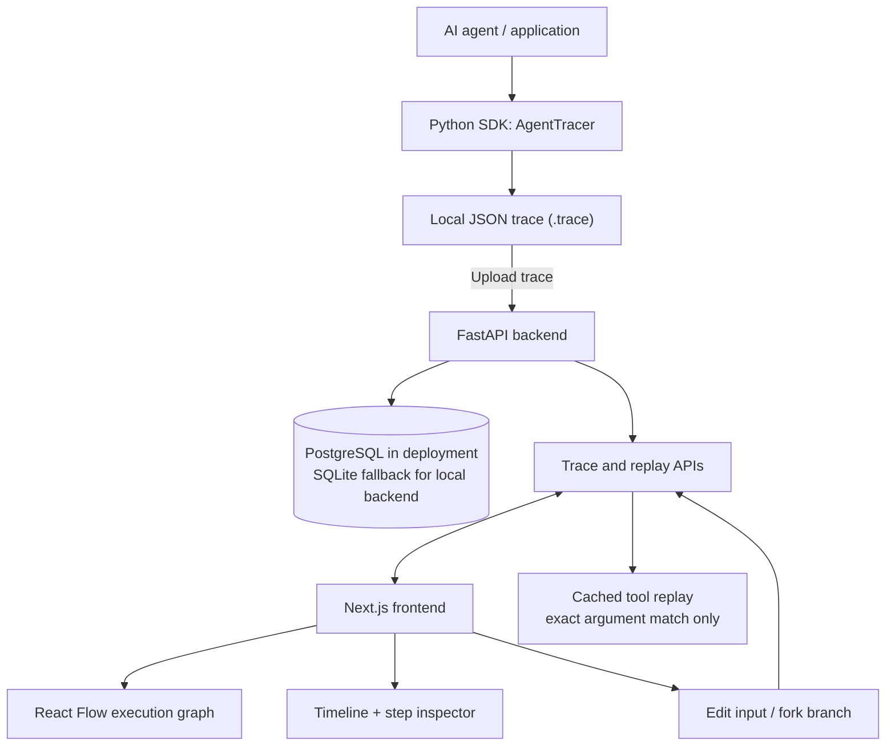

# AI Time-Travel Debugger

**Your AI agent failed 7 steps ago. Rewind it instead of rerunning everything.**

Time-travel debugging and replay infrastructure for AI agents.

Record an agent execution once, inspect every step, rewind to a historical state, edit the trajectory, and fork a replay branch without accidentally re-running external tools.

> **Core idea:** Logs tell you what happened. Time-travel debugging lets you explore what would have happened if you changed an earlier decision.

## 🚀 Try it

- **Live debugger:** https://ai-time-travel-debugger.onrender.com
- **API documentation:** https://ai-time-travel-debugger-api.onrender.com/docs
- **API health:** https://ai-time-travel-debugger-api.onrender.com/health
- **Database health:** https://ai-time-travel-debugger-api.onrender.com/health/db

The repository includes a sample trace at [`examples/demo.trace`](examples/demo.trace). To load it into a local or deployed backend, use the upload instructions in **Quick start** below. The UI loads trace `trc_demo_001` by default, so that trace must exist in the backend database for the initial view to populate.

## What it does

- Record LLM and tool execution steps, including inputs, outputs, status, and latency
- Visualize recorded execution as a React Flow graph
- Scrub through the execution timeline and inspect historical step inputs/outputs
- Edit a prompt/input and create a separate branch from a selected step
- Reuse recorded tool results when tool names and arguments match exactly
- Block unknown tool calls during cached replay rather than silently executing external side effects
- Optionally request a live LLM replay when an OpenAI API key is configured

## Architecture



### Main components

| Component | Responsibility |
|---|---|
| **Python SDK** (`sdk/`) | Captures execution steps and writes JSON trace files; includes optional LangChain callback integration. |
| **FastAPI backend** (`backend/app/`) | Imports traces, serves trace/step data, persists branches, and exposes replay endpoints. |
| **Replay engine** (`backend/app/replay_engine.py`) | Returns recorded tool results only for exact tool-name and argument matches; reports a cache miss otherwise. |
| **Next.js + React Flow UI** (`frontend/`) | Shows the execution graph, timeline, metrics, recorded inputs/outputs, and branch controls. |
| **Database** | PostgreSQL in Docker Compose/Render configuration; SQLite fallback for local backend runs without `DATABASE_URL`. |

## Demo workflow

1. Start the local stack using the commands below.
2. Upload the bundled demo trace to the API.
3. Open the debugger and inspect the four recorded steps.
4. Select a step, edit the prompt/input in the inspector, and click **Fork & Replay Branch**.
5. Compare the new branch trace in the UI. Cached tool replay is limited to exact historical argument matches; a cache miss is blocked instead of invoking an unknown external tool.

This sample trace describes a fictional customer-support workflow. Do not upload traces containing secrets, credentials, or private customer data.

## Quick start

### Requirements

- Docker and Docker Compose
- Git

### Run the application

```bash
git clone https://github.com/UjwalBagalkoti/ai-time-travel-debugger.git
cd ai-time-travel-debugger
docker-compose up --build
```

Open:

- **Debugger UI:** http://localhost:3000
- **API docs:** http://localhost:8000/docs
- **API health:** http://localhost:8000/health
- **Database health:** http://localhost:8000/health/db

In a second terminal, upload the sample trace:

```bash
curl -X POST http://localhost:8000/api/v1/traces/upload \
  -F "file=@examples/demo.trace"
```

Then refresh the debugger at http://localhost:3000. The UI starts by requesting trace ID `trc_demo_001`.

### Optional: live LLM replay

The default branch workflow uses recorded state and cached replay. To enable the backend's optional live LLM replay endpoint, set `OPENAI_API_KEY` in your environment before starting Docker Compose. Live model calls can incur API charges. Never commit API keys or place them in a public trace.

## SDK example

The SDK can record custom steps and tool executions into a local trace file:

```python
from agent_tracer import AgentTracer

tracer = AgentTracer(
    agent_name="my-agent",
    output_path="my-agent.trace",
)

@tracer.trace_step(step_type="custom")
def calculate_total(items):
    return sum(items)

@tracer.wrap_tool("lookup_order")
def lookup_order(order_id):
    return {"order_id": order_id, "status": "delivered"}

calculate_total([10, 20, 30])
lookup_order("992")
```

Install the SDK requirements before running an example:

```bash
pip install -r sdk/requirements.txt
```

The SDK also includes an optional LangChain callback integration. Install its extra requirements with:

```bash
pip install -r sdk/requirements-langchain.txt
```

See [`examples/langchain_trace.py`](examples/langchain_trace.py) for the integration example. Callback coverage depends on the runnable/model implementation; verify capture against your specific LangChain stack.

## API overview

| Endpoint | Purpose |
|---|---|
| `GET /health` | Backend health check |
| `GET /health/db` | Database connectivity check |
| `POST /api/v1/traces/upload` | Import a trace file |
| `GET /api/v1/traces` | List imported traces |
| `GET /api/v1/traces/{trace_id}` | Get a trace and its steps |
| `GET /api/v1/traces/{trace_id}/step/{step_id}` | Inspect a single step |
| `POST /api/v1/replay/tool` | Look up a cached tool result |
| `POST /api/v1/replay/branch` | Create a branch from a historical step |

For full request/response schemas, run the API and visit `/docs`.

## Project structure

```text
sdk/       Python agent tracing SDK and integrations
backend/   FastAPI API, database models, replay engine, tests
frontend/  Next.js debugger UI and React Flow canvas
examples/  Demo trace and LangChain integration example
```

## Tests

Run the backend replay-engine tests:

```bash
cd backend
pytest
```

## Current scope and limitations

This is an early working implementation intended as a foundation for deeper agent observability and replay. It does not automatically capture every framework or external side effect; integrations need to be instrumented and verified. The bundled demo is synthetic. Cached tool replay requires an exact tool-name and argument match, and a cache miss does not execute the tool.

## Contributing

Contributions are welcome, especially integrations for LangGraph/CrewAI, replay-diff visualization, trace search/filtering, deterministic replay tests, and improved failure navigation.

See [`CONTRIBUTING.md`](CONTRIBUTING.md) for contribution guidelines.

## Links

- **Live debugger:** https://ai-time-travel-debugger.onrender.com
- **API docs:** https://ai-time-travel-debugger-api.onrender.com/docs
- **GitHub:** https://github.com/UjwalBagalkoti/ai-time-travel-debugger
